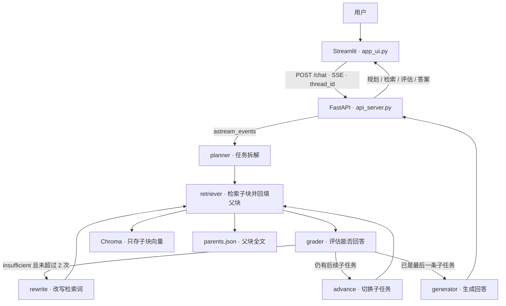

# ReflexRAG

基于自我反思的 Agentic 深度研究智能体。面向长篇中文债券财报，把比较型、多跳问题拆成可检索的子任务，用检索质量评估决定是改写查询还是继续作答，并把规划、检索、评估过程实时展示给用户。

当前语料是两份真实的公司债券 2026 半年度报告：中海企业发展集团有限公司、四川发展（控股）有限责任公司。系统要回答的不是摘要型闲聊，而是「哪家公司的短期借款更多」这类必须落到具体报表行的问题。

## 核心特性

### 智能任务拆解（Planning）

规划节点基于 LangGraph。简单问题保持为一条检索任务；问题同时涉及两家公司或两个指标时，拆成多条独立子任务，每条都保留公司名和会计科目。子任务顺序执行，完成一条后由 `advance` 切到下一条，全部材料汇总后再生成答案。

### 反思与重试（Reflection）

`grader` 阅读当前子任务的检索材料，只给出 `sufficient` 或 `insufficient`。材料不足以回答时，`rewrite` 结合原查询和上一轮命中改写检索词，并回到检索节点。每个子任务最多改写 2 次。改写耗尽后不再空转：后面还有子任务就继续下一条，否则用已有材料生成回答。

### 高级表格检索

财报里的关键数字住在表格中。解析阶段用 pdfplumber 识别表格，父块按页面保留整表，避免把一张表切碎后丢失表头。子块采用按行切分：表头与该行单元格拼成 `[项目: 短期借款, 2026年6月30日: 198,000,000, ...]`。向量库只索引这些短子块；命中后按 `parent_id` 取回父块全文，作为生成阶段的上下文。这样检索对准的是一行科目，而不是一整页稀释后的向量。

### 流式 UI 渲染

FastAPI 通过 `astream_events` 监听 LangGraph，再用 Server-Sent Events 推送中间状态。Streamlit 用固定 `thread_id` 维持多轮对话，并在回答出现之前展示「正在规划子任务」「检索到中海地产第 53 页」「评估结果：sufficient / insufficient」以及改写后的检索词。最终答案在思考过程结束后单独渲染。

## 系统架构



嵌入模型是 `BAAI/bge-small-zh-v1.5`，对话模型是 DeepSeek `deepseek-flash`（关闭思考模式，保证拆解、评估和改写返回稳定短文本）。检查点使用进程内的 `MemorySaver`，同一 `thread_id` 可以连续追问；服务重启后对话记忆清空。

## 技术栈

| 层次 | 选型 |
| --- | --- |
| 编排 | LangGraph StateGraph，条件边连接 grader、rewrite、advance、generator |
| 模型 | ChatDeepSeek `deepseek-flash`；HuggingFace `BAAI/bge-small-zh-v1.5` |
| 检索 | Chroma，余弦距离；父块留在 `parents.json`，不进入向量库 |
| 解析 | pdfplumber，表格转 Markdown，行级子块 |
| 服务 | FastAPI，`POST /chat` 以 SSE 推送节点事件 |
| 界面 | Streamlit，`st.status` 展示思考过程，`st.markdown` 展示答案 |

## 目录

| 文件 | 职责 |
| --- | --- |
| `parse_pdfs.py` | 解析 PDF，写出 `parents.json` 与 `children.json` |
| `build_index.py` | 只向量化子块，持久化到 `chroma_db/` |
| `state.py` | `AgentState`：问题、子任务、检索结果、评估、循环次数、消息 |
| `nodes.py` | planner、retriever、grader、rewrite、advance、generator |
| `main_graph.py` | 编译带 `MemorySaver` 的 StateGraph |
| `api_server.py` | FastAPI SSE 接口，默认 `127.0.0.1:8000` |
| `app_ui.py` | Streamlit 界面，默认 `8501`，`thread_id` 为 `reflexrag-ui` |
| `start.bat` | Windows 一键启动前后端 |
| `run_test.py` | 命令行跑通同一条多公司对比问题 |

## 快速启动

在项目根目录创建 `.env`：

```text
DEEPSEEK_API_KEY=你的密钥
```

双击 `start.bat`。脚本会设置 `HF_ENDPOINT=https://hf-mirror.com`，拉起 `python api_server.py`，等待 8 秒后再拉起 `streamlit run app_ui.py`。浏览器打开 Streamlit 给出的本地地址即可提问。

接口首次启动会加载本地嵌入模型并编译图。若页面提示无法连接，等 API 窗口完成加载后刷新即可。

索引已经随仓库中的 `chroma_db/` 和 `parents.json` 准备好。若更换 PDF，在项目目录重新执行：

```powershell
python parse_pdfs.py
python build_index.py
```
